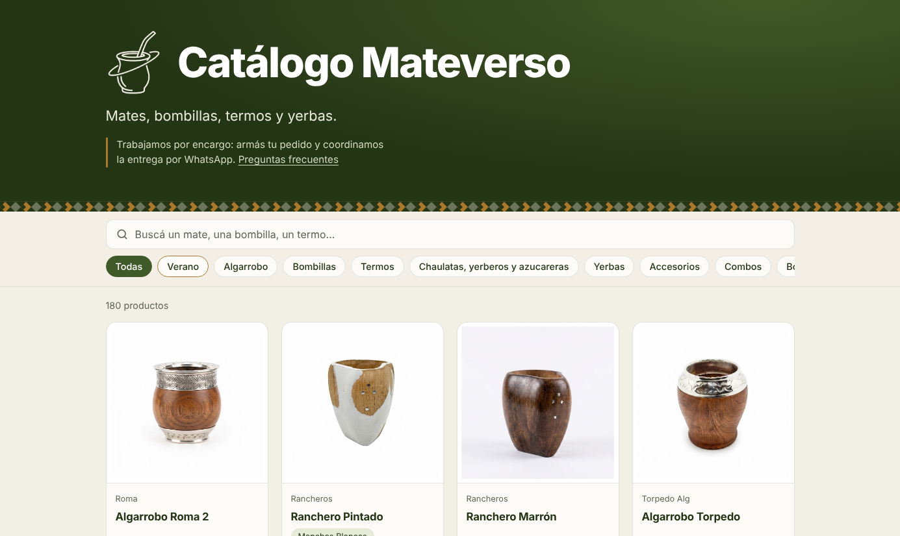
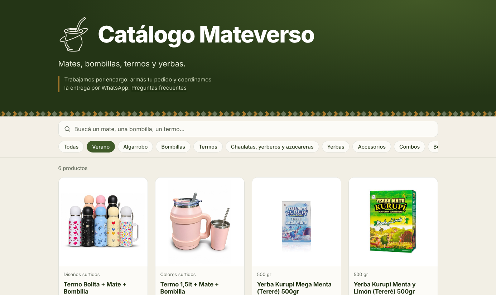
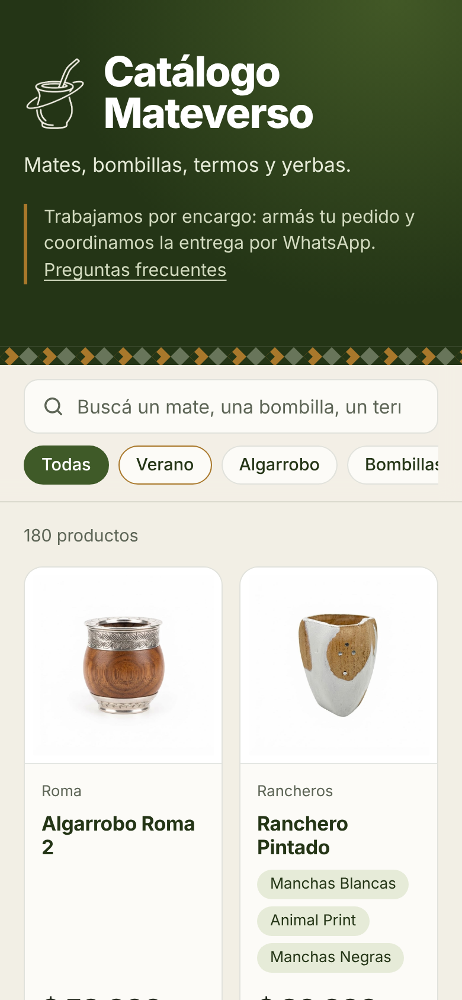

# Catálogo Mateverso

Catálogo online de **Mateverso**, mi emprendimiento de mates, con buscador y filtro por categoría. Hecho con **HTML, CSS y JavaScript** (sin librerías). Muestra más de 180 productos reales y arma el pedido por WhatsApp.

🔗 **Ver online:** https://janezsersen07.github.io/catalogo-mateverso/



<details>
<summary>Más capturas</summary>

La sección **Verano**, que reúne los productos de temporada:



En el celular:



</details>

## Qué hace

- Carga los productos desde un archivo `productos.json` usando `fetch` y `async/await`.
- **Buscador** por nombre, subcategoría o variante (color, modelo), que filtra mientras se escribe.
- **Filtro por categoría**: las opciones se generan solas a partir de los datos.
- Fotos de cada producto, con un respaldo si todavía no hay foto cargada.
- Variantes de cada producto (colores, modelos) como etiquetas.
- Contador de resultados y mensaje cuando no hay coincidencias.
- Botón de consulta por WhatsApp con el nombre del producto ya escrito en el mensaje.
- Diseño adaptable a celular y escritorio (CSS Grid).

## Conceptos de JavaScript que practiqué

- `fetch` + `async/await` + manejo de errores con `try/catch`
- `filter` para aplicar los filtros combinados
- `map` para generar las tarjetas
- `reduce` para obtener las categorías sin repetir
- Eventos (`input`, `change`) y manipulación del DOM
- Formato de moneda con `toLocaleString`

## Estructura

```
catalogo-mateverso/
├── index.html       Estructura de la página
├── style.css        Estilos
├── app.js           Lógica (carga, filtros, render)
├── productos.json   Datos de los productos
└── imagenes/        Fotos (un archivo por producto, nombrado con su slug)
```

## Cómo probarlo en tu compu

Como la página usa `fetch`, hay que abrirla desde un servidor local (no alcanza con doble clic en `index.html`). La forma más simple es instalar la extensión **Live Server** en VS Code y tocar **Go Live**.

## Autor

Janez · Estudiante de la Tecnicatura Universitaria en Programación (UTN Haedo)


## Fotos de los productos

Cada producto muestra su foto desde `imagenes/`. Los campos nuevos de `productos.json`:

- `foto`: foto principal de la tarjeta.
- `fotosVariantes`: foto por variante (color, diseño). Esas variantes se ven como botones: al tocarlas cambia la imagen y el mensaje de WhatsApp incluye la variante elegida.
- `galeria`: lista de fotos de ejemplo (la usa "Grabado Predeterminado", con el botón "Ver ejemplos").

Si una foto no existe, la tarjeta muestra el emoji de mate en su lugar.

### Preparar las fotos

Las fotos originales son pesadas, así que `preparar-fotos.ps1` las copia y achica (máx. 900 px, JPG) con los nombres que usa el catálogo, según `plan-fotos.csv`. Los originales no se modifican.

```powershell
.\preparar-fotos.ps1 -Origen "C:\ruta\a\PRODUCTOS" -Prueba   # prueba con 3 fotos
.\preparar-fotos.ps1 -Origen "C:\ruta\a\PRODUCTOS"           # todas
```

## Pedido por WhatsApp

Mateverso trabaja por encargo, así que el catálogo permite armar un pedido y enviarlo por WhatsApp:

- Cada tarjeta tiene "Agregar al pedido". Si el producto tiene variantes (color, diseño), hay que elegir una antes.
- El botón flotante "Mi pedido" abre el detalle: se puede sumar, restar o quitar productos, y muestra el total estimado.
- "Enviar pedido por WhatsApp" abre el chat con el mensaje armado (productos, variantes, cantidades, total y la consulta por cómo coordinar la entrega).
- El pedido se guarda en el navegador (`localStorage`), así que no se pierde si se cierra la página.
- Los precios se leen de `productos.json` cada vez, por lo que si cambian, el pedido se actualiza solo.
- El pedido no cobra ni controla stock: es un mensaje armado. El pago, la disponibilidad y la entrega se coordinan por WhatsApp.

## Diseño

- Paleta basada en la marca: verde yerba profundo, papel crema y un acento bronce (como las bombillas de alpaca/bronce).
- La franja de rombos debajo de la portada es una guarda tradicional dibujada con CSS (un SVG embebido).
- Los filtros quedan fijos arriba al hacer scroll; las categorías son botones que se deslizan en celular.
- Grilla de 2 columnas en celular y de 4 en pantallas grandes; mientras cargan los productos se ven tarjetas de espera.
- El pedido aparece como hoja desde abajo en celular. Respeta `prefers-reduced-motion` y tiene foco visible para navegar con teclado.
- Tipografías: Bricolage Grotesque (títulos y precios) y DM Sans (texto), desde Google Fonts.

La carpeta `logo/` tiene el logo de Mateverso en versión clara (para fondos oscuros) y verde (para fondos claros), el ícono solo y el favicon. Se generaron a partir del logo original, quitándole el fondo de papel para que tengan transparencia.

## Link directo a un producto

Cada tarjeta tiene un botón "Copiar link". El link tiene la forma `…/catalogo-mateverso/?producto=slug` (y `&variante=Negro` si había una variante elegida). Al abrirlo, el catálogo muestra solo ese producto, con un botón "Ver todo el catálogo". Si el producto ya no existe, avisa y muestra el catálogo completo.

Se usa el campo `slug` de `productos.json`, así que no hay que cargar nada nuevo. Si cambiás el `slug` de un producto, los links que ya compartiste con el slug viejo dejan de apuntar a él.

## Productos agotados

Un producto con `"agotado": true` en `productos.json` se muestra atenuado, con la etiqueta "Agotado", al final de la lista. No se puede agregar al pedido: en su lugar tiene "Consultar si vuelve", que abre WhatsApp. Los productos agotados también se descartan del pedido guardado.

## Preguntas frecuentes

Al final de la página hay un bloque de preguntas frecuentes (cómo pedir, pago y seña, tiempos, envíos, grabados, cambios y atención), armado con `<details>` y `<summary>`: se abre y se cierra sin JavaScript, y funciona con teclado. El texto está en `index.html`.

## Sección Verano

Un producto con `"verano": true` en `productos.json` aparece también en el botón **Verano**, además de en su categoría. Si ningún producto tiene ese campo, el botón no se muestra.
